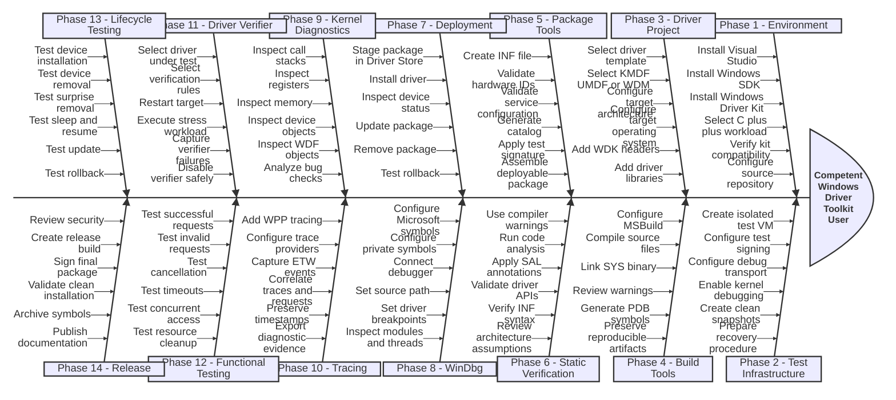
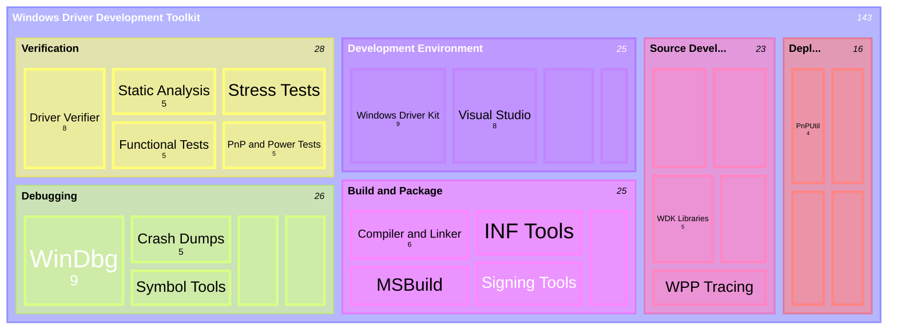

    

        
    

# **`WDDT`** | Windows Driver Development Toolkit

 

##

### My Other Awesome Lists
You can access the my other awesome lists [here](https://cyberthreatdefence.com/my_awesome_lists)

### Contributing
[Contributions of any kind welcome, just follow the guidelines](contributing.md)!

### Contributors
[Thanks goes to these contributors](https://github.com/cybersecurity-dev/windows-driver-development-toolkit/graphs/contributors)!

[🔼 Back to top](#wddt--windows-driver-development-toolkit)
